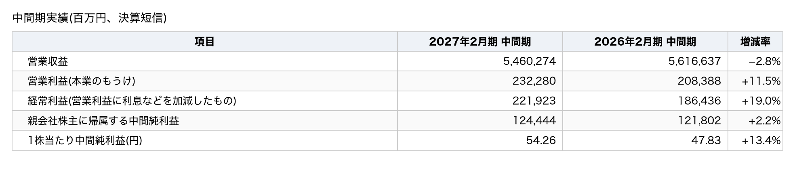
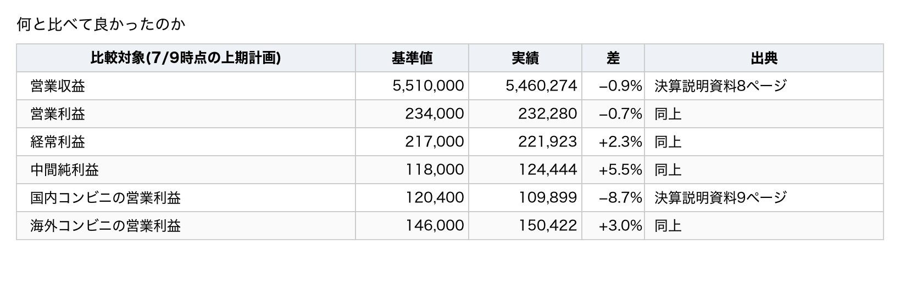
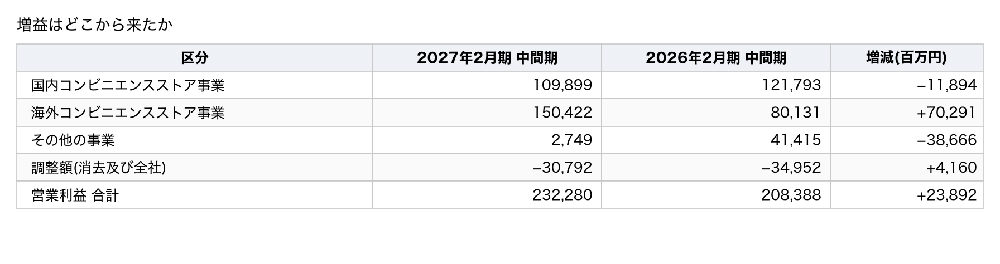
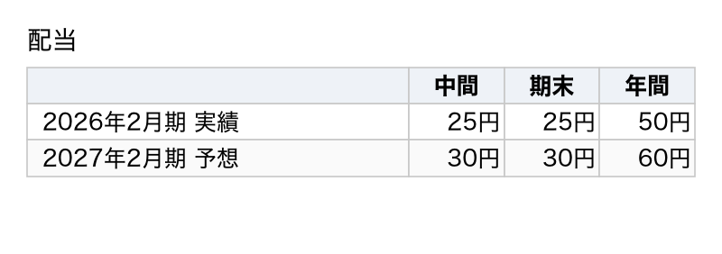
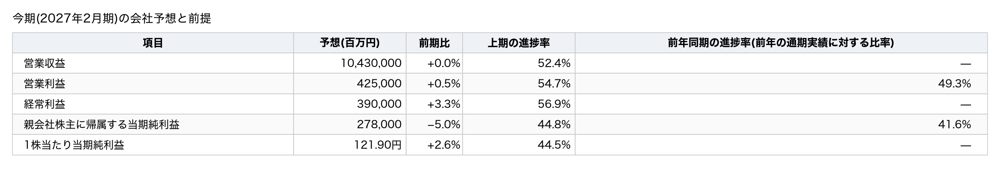

題名: 【決算メモ】セブン&アイ(3382)営業利益+12%でも株価は横ばい — 国内コンビニは会社計画を105億円下回った。据え置いた通期予想は下期に何を求めているか

このメモは、2027年2月期の第2四半期(中間期。2026年3月〜8月)の決算を扱う。数字は決算短信、決算補足資料、決算説明資料から取った。株価・アナリスト予想は米国版 Yahoo Finance(finance.yahoo.com)の掲載値を使い、報道の見出しは株探から引いた(取得日時は出典欄に書いた)。本文の算出値は筆者の計算であり、会社の開示ではない。

## 0. 3行でわかる今回の決算

1. 中間期の営業利益は2,323億円(前年同期比+11.5%)、経常利益は2,219億円(+19.0%)だった。親会社株主に帰属する中間純利益(税金や特別な損益を差し引いた最後のもうけ)は1,244億円で、伸びは2.2%にとどまった。
2. 通期の会社予想は、7月に上方修正した数字のまま変えていない。年間配当は50円から60円へ増やす予想で、中間配当30円は確定した。
3. 営業利益は12%増えたのに、翌営業日(10/9)の株価は+0.2%で動かなかった。何が足りなかったのか。

## 1. 実績

### 中間期実績(百万円、決算短信)

営業利益は11.5%、経常利益は19.0%伸びた。純利益の伸びは2.2%にとどまった。1株利益は株数が減ったため、純利益より大きく13.4%伸びた。

営業収益が減ったのは、前年の中間期にヨーク・ホールディングス傘下の子会社とセブン銀行が連結決算の対象に含まれていたためである。これらの影響を会社が調整した参考値(会社は「実質ベース」と呼ぶ)では、営業利益は36.6%増えた(決算短信 添付2ページ)。

### 有料部分で分かること

- 営業利益は12%増えた。それなのに、株価はなぜ動かなかったのか。7月時点の会社計画と比べて、どの事業がいくら足りなかったかを示す。
- 据え置いた通期予想を中間期の実績と突き合わせると、会社は下期に国内コンビニへ何%の増益を求めている計算になるか。会社資料には書かれていない数字を出す。
- 海外コンビニの増益703億円の中身はどこにあるか。米国の増益を商品、ガソリン、販管費に分けて示す。
- 経常利益+19%なのに純利益+2%という差を、損益計算書の各段階の数字で説明する。
- 4,000億円の自己株式取得と同じ月に、会社は何をしたか。消却・取得・処分を日付順に並べる。
- 次回(1月上旬の第3四半期)の決算で確かめる5項目を挙げる。

（ここに有料ラインを設定）

### 先に結論

- 株価が動かなかった理由として最も有力なのは、営業利益が7月時点の会社計画(2,340億円)を0.7%下回ったことである。なかでも国内コンビニは計画を105億円(8.7%)下回った。良い数字は7月の上方修正の時点で株価に反映済みだった、と筆者は推論する。株探の見出しも「サプライズ感薄く」と伝えているが、どの数字が材料になったかは示していない。
- 会社は通期の営業利益予想4,250億円と、セグメント別の通期予想を据え置いた。中間期の実績を引くと、下期の国内コンビニには1,143億円、前年同期比13.5%の増益が求められる計算になる(筆者の計算)。第2四半期の3か月では国内コンビニは14.3%減益だったので、この落差が通期予想の最大の論点である。
- 米国 7-Eleven, Inc. の営業利益の増加4.14億ドルのうち、ガソリンが3.98億ドルを占めた(会社の決算説明資料14ページ)。商品の寄与は0.25億ドルにとどまった。
- 純利益の伸びが2.2%にとどまった最大の要因は、前年同期にあった固定資産売却益394億円がなくなったことである。特別損失の増加がこれに次ぐ。一方で、税負担率の低下と、非支配株主(子会社の少数株主)に帰属する利益の減少が、減少分の一部を打ち消した。

### 何と比べて良かったのか

日本株では会社予想が基準になる。会社は7月9日に上期(中間期)の計画を示していたので、それと比べた。

営業利益は会社の上期計画を0.7%下回り、純利益は5.5%上回った。国内コンビニは計画を8.7%下回り、海外コンビニは3.0%上回った。

純利益が計画を上回ったのは、営業利益より下の段階が改善したためである。経常利益は計画を49億円上回り、税負担率は28.1%(前年同期37.3%)に下がった。営業利益の未達は国内コンビニに集中している。

## 2. 増益はどこから来たか

営業利益は前年同期比で238億9,200万円増えた。決算短信のセグメント別営業利益で分解すると、次のようになる(百万円未満の切捨てのため、合計と1百万円の差がある)。前年同期の数字は、今期から変えた区分に会社が組み替えたものである(決算短信 添付3ページ)。

海外コンビニが703億円増やした(会社の説明資料は702億円と丸めている)。国内コンビニは119億円、その他の事業は387億円減らした。全社費用は42億円減った。

その他の事業の減少は、事業の悪化ではない。前年の中間期には、セブン銀行(2025年6月24日まで)とヨーク・ホールディングス傘下の子会社(2025年9月1日まで)が連結決算の対象に含まれていた。これらを除いた参考値(実質ベース)では、会社は営業利益を36.6%増と示している。為替は営業利益を94億円押し上げた(決算短信 添付2ページ)。

### 海外コンビニの増益703億円の中身

海外コンビニの大半は米国の 7-Eleven, Inc.(SEI)である。SEI の中間期の営業利益は13.20億ドルで、前年同期から4.14億ドル増えた(決算説明資料14ページ)。会社はその内訳を次のように示している(項目の合計は4.15億ドルで、丸めによる差がある)。

- 商品等: +25
- ガソリン: +398
- 販売費・一般管理費(販管費): −8
- 合計: +414

ガソリンの寄与は増益の96%にあたる(筆者の計算)。会社はガソリンの増益要因として「ガソリン市況」と「垂直統合効果」(燃料の調達や卸売を自社で担うことによる利益、と会社は説明している)を挙げているが、両者の金額は分けていない(同ページ)。ガソリンに伴うクレジットカード手数料の増加0.52億ドルは、販管費ではなくガソリンの欄に含めている(同ページの注)。本メモは、垂直統合の効果の額を検証していない。

米国内の既存店商品売上は中間期で0.6%増えた。商品の粗利益率(売上に対する粗利益の割合。会社は「荒利率」と書く)は33.5%で、0.3ポイント改善した。ただし第2四半期の3か月は、ガソリン価格が高い水準で推移するなど外部環境が厳しく、客数が減った。このため米国内の既存店商品売上は前年同期をやや下回った(決算短信 添付4ページ)。

海外コンビニの中間期+87.7%という伸び率には、前年の第1四半期の営業利益が87億円と小さかったことが大きく影響している(決算補足資料3ページ)。四半期ごとに見ると、第1四半期は656億円(前年87億円)、第2四半期は848億円(前年714億円、+18.7%)だった。

### 国内コンビニの減益119億円の中身

セブン-イレブン・ジャパンの営業利益は1,102億円で、112億円減った(決算説明資料10ページ)。会社の分解では、収入等の増加が+59億円、粗利益率の変化が−1.3億円、販管費の増加が−170億円である。販管費の増加のうち、システム費用が87億円、広告宣伝費が18億円を占めた(同10ページ)。既存店売上は1.1%伸びた。客数は1.7%減ったが、客単価が2.8%上がって補った(決算補足資料19ページ)。第2四半期の3か月では、既存店売上の伸びは0.3%に鈍り、客数は2.5%減った。

会社は「システム費用の増加影響は第4四半期で一巡する」「上期の販管費は計画線」と説明している(決算説明資料10ページ)。

### 第2四半期(6〜8月)の3か月だけを見ると

決算補足資料の四半期の数値(参考値)から、第2四半期の3か月だけを取り出した。

- 営業収益: 3,081,454（前年同期: 2,839,267、増減率: +8.5%）
- 営業利益: 127,241（前年同期: 143,311、増減率: −11.2%）
- 経常利益: 121,188（前年同期: 133,155、増減率: −9.0%）
- 親会社株主に帰属する純利益: 63,844（前年同期: 72,787、増減率: −12.3%）
- 国内コンビニの営業利益: 57,664（前年同期: 67,260、増減率: −14.3%）
- 海外コンビニの営業利益: 84,830（前年同期: 71,444、増減率: +18.7%）

中間期の営業利益+11.5%は、第1四半期の+61.4%(1,050億円、前年651億円)の伸びによるものである。第2四半期だけを見ると、営業利益は11.2%減り、国内コンビニは14.3%減った。前年の第2四半期の「その他の事業」の利益219億円には、ヨーク・ホールディングスとセブン銀行の利益が大半を占めていた。これらを会社が調整した参考値(実質ベース)で比べると、第2四半期の営業利益は3.6%増になる(決算補足資料3ページ)。つまり連結全体の減益は連結の範囲の変化で説明できるが、国内コンビニの減益はそれとは関係がない。国内コンビニの前年同期の数字も今期の区分に組み替えたもので、連結から外れた会社は前年もその他の事業に含まれていた(決算短信 添付14ページ)。

## 3. 財務と配当

現金及び預金は4,402億円で、前期末とほぼ同じである(決算説明資料20ページ)。自己資本比率は39.1%で、前期末の39.6%からわずかに下がった。中間期に営業活動で得た現金(営業キャッシュフロー)は3,370億円で、450億円減った。投資に使った現金は1,682億円だった。差し引きで手元に残る現金(フリーキャッシュフロー)は1,687億円のプラスである(同23ページ)。

### 自己株式は消却・取得・処分の順に動いた

中間期に会社は自己株式について3つのことを行った(決算短信 添付15〜16ページ)。

- 7月15日: 自己株式の消却(発行済株式数が減る)（株数: 284,297,500株、金額: 帳簿価額5,995億円）
- 8月3日: 自己株式の取得(取引所の通常の売買時間外に行う立会外取引、1株2,109円)（株数: 189,663,300株、金額: 4,000億円）
- 8月17日: 自己株式の処分(ソフトバンク、PayPay、三井住友カードの3社に割り当てる第三者割当)（株数: 144,927,534株、金額: 帳簿価額3,057億円(払込額3,000億円)）

発行済株式数が2,604,555,849株から2,320,258,349株へ減ったのは、7月15日の消却による。8月3日の取得4,000億円のうち3,673億円分は証券会社から買い付けた(決算短信 添付6ページ)。この分には、後日の平均株価に応じて取得価額を調整する仕組みを使っている。処分の払込額は3,000億円で、帳簿価額3,057億円との差は資本剰余金から減らした(同15ページ)。会社は中間期の自己株式の取得を、処分の3,000億円を差し引いた「ネット1,000億円」と説明している(決算説明資料18ページ)。処分先の3社とは、決済や会員基盤を使った販促で提携する(同13ページ)。会社は2030年度までに累計2兆円の自己株式を取得する計画を示しており、これまでに7,000億円を取得済みで、残りは1.3兆円である(同18ページ)。10月8日の取締役会では、1,200億円以下の社債の発行枠も決めた(決算短信 添付16ページ)。

参考として、10月9日の終値1,991.5円は、8月3日の取得単価2,109円を5.6%下回る(筆者の計算)。

### 配当

年間配当は50円から60円へ増える予想で、中間配当30円は確定した。会社は配当を減らさない方針(会社は「累進配当」と呼ぶ)を示している(決算説明資料18ページ)。これは会社の方針であり、将来の配当を約束するものではない。

## 4. 株価の反応

開示は10月8日の15時30分で、取引終了と同時だった。反応は翌営業日の10月9日の取引で出た。

- 10/8 終値(開示前の最後の値): 1,987.5円（補足: 前日比+1.02%）
- 10/9 始値: 1,960.0円（補足: 前日終値比−1.38%。取引開始時は安かった）
- 10/9 安値: 1,943.5円（補足: 前日終値比−2.21%）
- 10/9 高値: 2,026.5円（補足: 前日終値比+1.96%）
- 10/9 終値: 1,991.5円（補足: 前日終値比+0.20%）
- 10/9 出来高: 12,223,500株（補足: 直近20営業日平均(7,695,995株)の1.59倍）
- 同日の TOPIX連動上場投資信託(1306): +0.70%（補足: TOPIX の代理指標として使用）
- 同日の日経平均: −0.02%

- **値幅制限の確認**: 基準値段1,987.5円の制限値幅は上下400円(JPX)で、当日の値動きは届いていない。
- **通常の値動きとの比較**: 直近20営業日の前日比の絶対値平均は0.77%である。終値の+0.20%はその範囲内であり、終値で見るかぎり反応は出ていない。ただし日中の値幅は4.2%(安値−2.2%から高値+2.0%)で、出来高は平均の1.6倍だった。売りと買いが交錯して終値は動かなかった、と筆者は読む。
- **市場との対比**: TOPIX の代理指標が0.7%上がった日に+0.2%なので、市場よりわずかに弱かった。

株探の見出しは「セブン＆アイは冴えない、８月中間期営業益１２％増もサプライズ感薄く売り優勢」(2026-10-09 09:27)だった。見出しは取引開始直後の下げを伝えており、その後の戻りは含んでいない。見出しは「サプライズ感薄く」という要因を挙げているが、どの数字がそう受け取られたかは示していない。

株価が動かなかった理由として、本メモの数字からは次の点が候補に挙がる。営業利益は7月に上方修正した上期計画をわずかに下回り、国内コンビニは計画を105億円下回った。米国の増益はガソリンに集中している。第2四半期の3か月では営業利益が減った。良い数字は7月の上方修正ですでに知られており、新たに分かったのは国内の弱さと増益の中身だった、というのが筆者の推論である。会社は理由を説明していない。

参考(算出値であり、水準の評価は含まない): 10月9日の終値1,991.5円は、今期の会社予想1株利益121.90円の16.3倍にあたる(株価収益率、予想ベース)。今期配当予想60円に対する配当利回りは3.01%になる。1株当たり純資産1,634.86円に対しては1.22倍(株価純資産倍率)になる。

## 5. 今期(2027年2月期)の会社予想と前提

通期の会社予想は7月9日の修正のまま変えていない。営業利益の進捗率は54.7%で、前年同期の49.3%より高い。純利益の進捗率は44.8%で、前年同期の41.6%より高い。

### 会社予想の修正の履歴

- 2026年4月(期初): 4,050（当期純利益(億円): 2,700、為替の前提(円/米ドル): 150.00）
- 2026年7月9日(修正): 4,250（当期純利益(億円): 2,780、為替の前提(円/米ドル): 157.00）
- 2026年10月8日(据え置き): 4,250（当期純利益(億円): 2,780、為替の前提(円/米ドル): 157.00）

7月の上方修正200億円のうち、海外コンビニが222億円を占めた(7月の決算説明資料17ページ)。為替の前提を150円から157円に動かした効果は、SEI の通期営業利益の予想24.5億ドルに7円を掛けると約170億円になる(筆者の概算)。したがって上方修正の主因は為替の前提で、事業の上振れは残りの約50億円と筆者は推定する。会社はこの内訳を示していない。

### 据え置いた通期予想は、下期に何を求めているか

会社は通期予想を据え置いたが、上期の国内コンビニは計画を105億円下回った。通期予想から中間期の実績を引くと、下期に求める数字が逆算できる(筆者の計算。会社は下期の数字を今回は示していない)。

- 営業利益(連結): 425,000（中間期の実績: 232,280、下期に必要な額: 192,720、前年の下期: 214,605、前年比: −10.2%）
- 国内コンビニの営業利益: 224,200（中間期の実績: 109,899、下期に必要な額: 114,301、前年の下期: 100,728、前年比: +13.5%）
- 海外コンビニの営業利益: 270,000（中間期の実績: 150,422、下期に必要な額: 119,578、前年の下期: 142,092、前年比: −15.8%）
据え置いた通期予想を達成するには、下期に国内コンビニで前年同期比13.5%の増益、海外コンビニで15.8%の減益、という組み合わせが必要になる(筆者の計算)。

7月時点で会社が示していた下期の計画は、国内コンビニが1,038億円(+3.0%)、海外コンビニが1,240億円(−12.7%)だった(7月の決算説明資料38ページ)。据え置いた通期予想は、上期の国内コンビニの未達105億円をそのまま下期に上乗せした形である。会社は、第2四半期に14.3%減益だった事業に、下期は13.5%の増益を求めていることになる。会社は、システム費用の増加が第4四半期で一巡すると説明している。客数の減少が続くなかで達成できるかが、通期予想の最大の論点だと筆者は考える。海外コンビニについては、ガソリンの追加利益が下期には出ないという前提を、会社が置いている計算になる。

### 経常利益+19%なのに純利益+2%なのはなぜか

損益計算書の各段階で前年同期との差を並べると、次のようになる(決算短信 添付9ページ)。

- 経常利益: +35,487（内容: 本業と利息などの改善）
- 特別利益: −41,979（内容: 前年の固定資産売却益394億円が27億円に減った）
- 特別損失: −22,932（内容: 減損損失が80億円から230億円へ、その他が155億円から219億円へ増えた）
- 法人税等: +27,037（内容: 税引前利益が14.5%減ったことと、税負担率が37.3%から28.1%に下がったことによる）
- 非支配株主に帰属する利益: +5,031（内容: セブン銀行の非連結化で57.5億円から7.2億円に減った）
- 親会社株主に帰属する中間純利益: +2,642

最大の要因は特別利益の減少であり、特別損失の増加はその半分ほどである。税負担の減少と非支配株主に帰属する利益の減少が、合わせて320億円分を打ち消した(5段階の合計は切捨てのため2百万円ずれる)。税負担の減少270億円のうち、税率の低下による分は約160億円で、残りは税引前利益が減ったことによる(筆者の計算)。非支配株主に帰属する利益の減少50億円はセブン銀行が連結から外れたことで生じた一方、非連結化で失った利益のほうがはるかに大きく、会社の参考値(実質ベース)では純利益は17.8%増えている(決算短信 添付2ページ)。減損損失230億円の対象と、特別損失「その他」219億円の内訳は、決算短信には書かれていない。

通期の純利益予想は前期比5.0%減である。経常利益は3.3%増える予想なので、両者の開きは特別損益と税率の前提の違いによるものと筆者は推定する(会社は通期の特別損益と税率の前提を開示していない)。

アナリスト予想平均は、今期の1株利益が123.26円(9名)で、会社予想121.90円を1.1%上回る。営業収益は10兆5,077億円(人数は非公開)で、会社予想を0.7%上回る(Yahoo Finance)。

### 会社が置いた前提

- 為替は通期で157.00円/米ドル、23.00円/人民元を前提にしている。中間期の実際の換算レートは158.29円/米ドルだった(決算短信 添付2ページ)。
- SEI は、通期の米国内既存店商品売上を1.3%増、商品の粗利益率を33.8%、ガソリン販売量を1店当たり3.7%減と置いている(7月の決算説明資料39ページ)。
- セブン-イレブン・ジャパンは、通期の既存店売上を2.5%増と置いている(決算補足資料19ページ)。中間期は1.1%増だった。

## 6. 次回の決算で確かめること

会社は今期計画の前提として、国内コンビニは下期に増益へ戻り、米国はガソリンの追加利益が消えても商品で稼ぐ、と置いている(筆者が会社の計画数値を整理した読み方であり、会社の言葉ではない)。この節の確認項目は、その前提が成り立っているかを確かめるためのものである。保有や売買の判断基準ではない。初回なので前回分の確認はない。次回は1月上旬の第3四半期(9〜11月)で結果を確かめる。

**国内コンビニは下期に増益へ戻るか**
- 今回の結果: 中間期の営業利益は119億円減り、第2四半期は14.3%減った
- 次回の確認点: 第3四半期の営業利益が前年同期(567億円)を上回るか。据え置いた通期予想は下期に+13.5%(1,143億円)を求めており、第3四半期だけで前年並みでは足りない

**米国の増益はガソリン以外でも出るか**
- 今回の結果: 増益4.14億ドルのうちガソリンが3.98億ドルを占めた。商品等は0.25億ドルにとどまった
- 次回の確認点: 第3四半期の商品等の寄与がプラスを保つか。商品の粗利益率が33.5%を保つか

**米国の既存店商品売上は戻るか**
- 今回の結果: 中間期は0.6%増えたが、第2四半期はやや減った
- 次回の確認点: 第3四半期がプラスに戻るか。会社は下期の前提を+2.1%としている(7月の決算説明資料39ページ)

**国内の既存店の客数減は止まるか**
- 今回の結果: 中間期の客数は1.7%減り、第2四半期は2.5%減った
- 次回の確認点: 第3四半期の客数の減少幅が縮むか。通期の既存店売上の前提は+2.5%である

**特別損失と税率**
- 今回の結果: 特別損失は541億円(うち減損230億円)で、税負担率は28.1%だった
- 次回の確認点: 第3四半期に減損が続くか。通期の純利益予想2,780億円に対して進捗がどこまで来たか

第3四半期に国内コンビニの営業利益が前年同期を下回り、かつ米国の商品の粗利益率が前年同期を下回った場合、筆者は会社計画の前提が崩れたとみなし、次回のメモでそのように扱う。

## 7. 次の予定

- 半期報告書の提出: 2026-10-14(決算短信)
- 中間配当の支払開始: 2026-11-13(決算短信)
- 社債の発行予定期間: 2026-10-23〜12-31(決算短信 添付16ページ)
- 次回決算(第3四半期)の予定日: 会社は公表していない。Yahoo Finance は2027-01-07と推定している。前年も会社は1月に発表した。
- 直近の休場日: 2026-10-12(月、スポーツの日)(JPX)

次回のメモは、第3四半期の発表翌営業日(1月上旬の見込み)に、第6節の5項目を確かめることから始める。

## 出典

- [2027年2月期 第2四半期(中間期)決算短信〔日本基準〕(連結)](https://www.release.tdnet.info/inbs/140120261007547460.pdf)(TDnet、2026-10-08 15:30 開示。2026-10-10 取得。「添付」はサマリーに続く添付資料のページ番号)
- [2027年2月期 第2四半期(中間期)決算補足資料](https://www.release.tdnet.info/inbs/140120261007547497.pdf)、[決算説明資料](https://www.release.tdnet.info/inbs/140120261007547515.pdf)(TDnet、同上)
- [2026年度 第1四半期 決算説明資料](https://www.7andi.com/ir/file/library/ks/pdf/2026_0709ks_01.pdf)(会社サイト、2026年7月9日。2026-10-11 取得)
- 米国版 Yahoo Finance([3382.T](https://finance.yahoo.com/quote/3382.T/)): 株価・出来高(2026-10-09 終値、2026-10-11 取得)、アナリスト予想平均と人数(2026-10-11 取得。掲載の集計値で、筆者の予想ではない)
- 株探: [銘柄ニュース一覧](https://kabutan.jp/stock/news?code=3382)の記事見出し(2026-10-09 09:27。2026-10-11 取得)
- JPX: [制限値幅](https://www.jpx.co.jp/equities/trading/domestic/06.html)の区分、[休業日一覧](https://www.jpx.co.jp/corporate/about-jpx/calendar/index.html)(2026-10-10 取得)
- 本文の算出値(株価指標、進捗率、下期に必要な額、為替の効果の概算)は筆者の計算で、会社の開示ではない

> **免責事項**: 本資料は、公開情報(TDnet の開示資料、会社の決算説明資料)および Yahoo Finance・株探に掲載された情報をもとに、不特定多数の読者向けに作成した情報提供資料です。筆者は金融商品取引業(投資助言・代理業を含む)の登録を受けておらず、本資料は特定の金融商品の売買を推奨・勧誘・助言するものではなく、特定の読者の投資目的や財産状況を考慮したものでもありません。会社予想・アナリスト予想は各発表者の前提に基づく将来情報で、その実現を保証するものではありません。株価・為替・アナリスト予想は取得時点(出典欄に記載)の値で、その後変動します。第三者の情報の権利は各提供者に帰属します。本資料中の算出値や逆算・推論は筆者の計算によるもので、会社の開示ではありません。掲載情報の正確性・完全性は保証されず、本資料に基づいて行った投資判断により生じた損失について、筆者は法令で認められる範囲で責任を負いません。筆者は公開時点で当該銘柄を保有していません。コメント欄等での個別の売買相談には応じません。TDnet のリンクは公開から約1か月で閲覧できなくなります。
