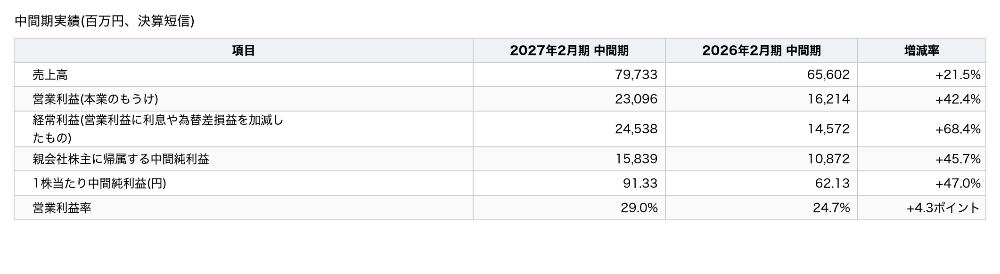
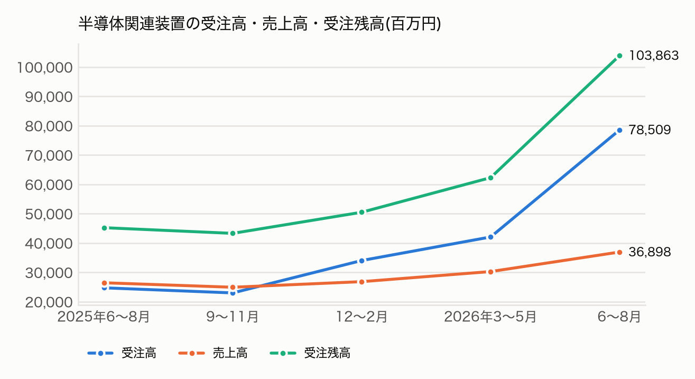
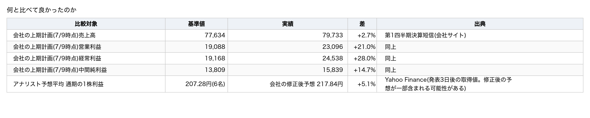
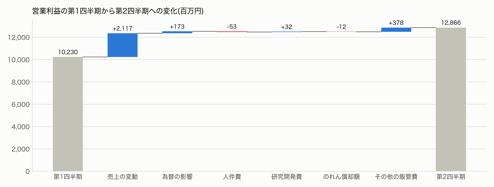
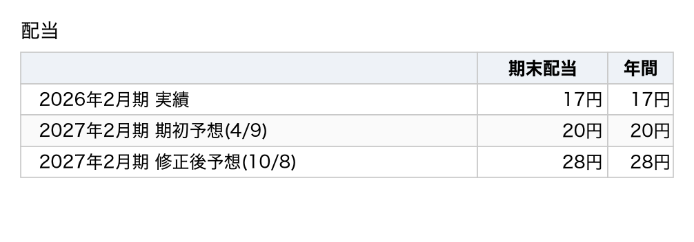
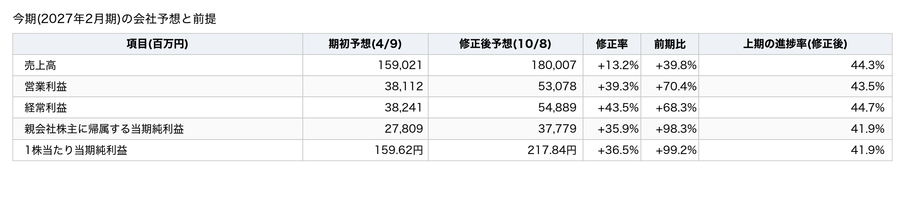
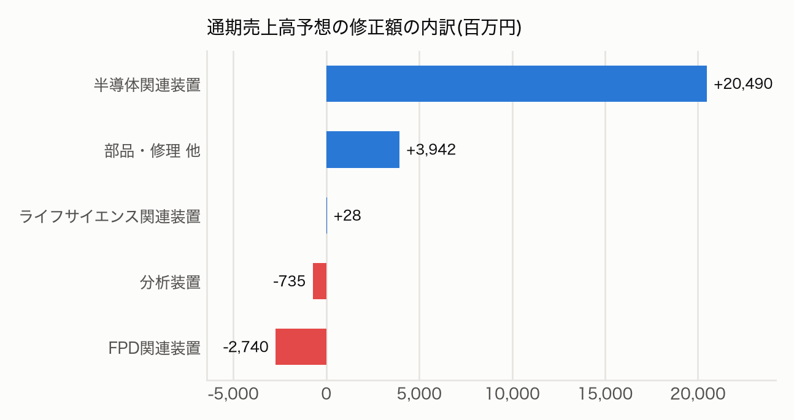
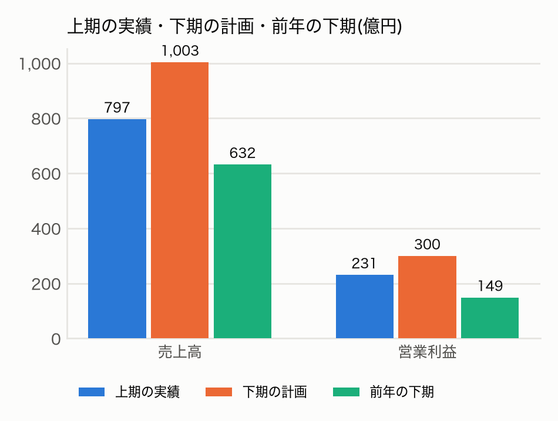
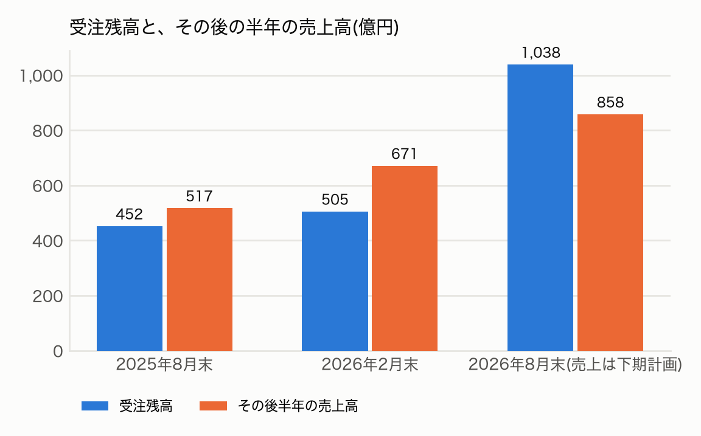

題名: 【決算メモ】ローツェ(6323)ストップ高。下期は営業利益を前年の2倍にする計画、受注残1,038億円で足りるか

このメモは、2027年2月期の第2四半期(中間期。2026年3月〜8月)の決算を扱う。ローツェは広島県福山市に本社を置く半導体製造装置向けの搬送装置メーカーで、東証プライムに上場している(TOPIX Mid400)。数字は決算短信、業績予想の修正のお知らせ、決算説明資料から取った。過去の予想は会社サイトの過去の決算短信から引用した。株価・アナリスト予想は米国版 Yahoo Finance(finance.yahoo.com)の掲載値を使い、報道の見出しは株探から引用した(取得日時は出典欄に書いた)。本文の算出値は筆者の計算であり、会社の開示ではない。

本記事は情報提供を目的とし、特定の銘柄の売買を勧めるものではない。筆者は金融商品取引業の登録を受けていない。筆者の保有の有無を含む免責事項の全文は末尾にある。

## 0. 3行でわかる今回の決算

1. 中間期の売上高は797億円(前年同期比+21.5%)、営業利益は231億円(+42.4%)で、会社はいずれも過去最高としている(決算説明資料5ページ)。会社は通期の営業利益予想を381億円から531億円へ39.3%引き上げ、期末配当の予想を20円から28円へ増やした。
2. 半導体関連装置の受注高(新たに受けた注文の額)は第2四半期(6〜8月)だけで785億円と前年同期の3.2倍になり、受注残高(注文を受けたがまだ売上にしていない額)は1,038億円と2.3倍になった(同5ページ)。
3. 翌営業日(10/9)の株価は値幅制限の上限(ストップ高)の5,134円で取引を終えた。上方修正の後の計画は、下期に前年の2倍の営業利益を求めている。受注残はそれを賄えるのか。

## 1. 実績

### 中間期実績(百万円、決算短信)

売上は21.5%、営業利益は42.4%伸び、営業利益率は29.0%に上がった。経常利益は為替差益も加わって68.4%伸びた。

第2四半期の受注高785億円は売上高369億円の2.1倍(筆者の計算)で、受注残高は1,038億円まで積み上がった(決算説明資料10ページ)。

### 有料部分で分かること

- 受注残高1,038億円は、下期の売上計画をどこまで裏付けるか。過去2回の「受注残高がその後の半年でどれだけ売上に変わったか」と比べて示す(筆者の計算)。
- 下期の営業利益300億円という計画は、前年の2倍という見かけほど無理な数字か。四半期あたりに直し、第2四半期の実績と比べる(筆者の計算)。
- 上方修正150億円のうち、上期の上振れと下期の見通しの引き上げはそれぞれいくらか。
- 会社が7月に示していた上期の計画と比べて、どの利益段階がどれだけ上振れたかを示す。
- ストップ高の15.8%という数字が何を意味し、何を意味しないか。発表前の約1か月の値動きを市場や同業と比べる。
- 次回(1月上旬の第3四半期)の決算で確かめる5項目を挙げる。

（ここに有料ラインを設定）

### 先に結論

- 半導体関連装置の受注残高1,038億円は、下期の同装置の売上計画858億円の1.2倍にあたる。受注残高のうち下期に納入する分の金額は開示されていないので、受注残がそのまま売上に変わるとは限らない。それでも、決算説明資料が示す過去5四半期(2025年6月以降)の範囲では、受注残高が半年分の売上計画を上回るのは今回が初めてで、量としては足りている。計画の鍵は需要より、納期と生産能力にあると筆者は読む(推論)。
- 下期の営業利益300億円は前年の下期(149億円)の2.0倍である。ただし四半期あたりに直すと150億円で、第2四半期の実績129億円より17%多い水準にとどまる。営業利益率は29.9%で、第2四半期(30.3%)と同じ水準を前提にしている(筆者の計算)。
- 上方修正150億円のうち、上期の上振れは40億円で、残り110億円は下期の見通しの引き上げである(筆者の計算)。
- ストップ高の15.8%は、値幅制限で決まった上昇率である。発表前の約1か月(9/10〜10/8)に株価は約2割(21.5%)上がっていた。同じ期間に東京エレクトロンは15.4%、アドバンテストは20.7%上がっており、半導体製造装置株が全体として上がった流れの中にあった。

### 何と比べて良かったのか

会社は7月9日に上期(第2四半期累計)の計画を示していたので、それと比べた。

上期の営業利益は会社計画を21.0%上回った。修正後の通期1株利益の会社予想は、アナリスト予想平均(6名)を5.1%上回る。

売上の上振れは2.7%にとどまったが、営業利益は21.0%上振れた。会社は計画の利益率を開示していないので、上振れを粗利率と販管費率に分けることはできない。前年同期と比べると、売上総利益率(売上から製造原価を引いた利益の割合)は40.0%から43.1%に上がり、販管費率(人件費や研究開発費など営業費用の割合)は15.3%から14.1%に下がった(決算短信の損益計算書から筆者が計算)。この利益率の改善が上振れの背景にあると筆者は読む(推論)。

## 2. 増益はどこから来たか

### 第1四半期から第2四半期への増益26億円

会社は第1四半期(3〜5月)から第2四半期(6〜8月)への営業利益の変化を、次のように分解している(決算説明資料9ページ)。

増益26億円のうち21億円は売上の増加によるもので、販管費の減少が3億円、為替が2億円だった(決算説明資料9ページ)。

半導体関連装置の売上は第1四半期の302億円から第2四半期の369億円へ22%増え、全体の増収を引っ張った(決算説明資料7ページ)。分析装置は、顧客の装置検収の時期のずれと、部品の調達や生産にかかる期間の長期化で減収になった(同6ページ)。ただし分析装置の受注残高は56億円と過去最高で、需要が消えたわけではない(同11ページ)。

### 前年同期との比較(中間期)

- 半導体関連装置: 67,138（2026年2月期 中間期: 54,650、増減率: +22.8%）
- 分析装置: 1,304（2026年2月期 中間期: 1,440、増減率: −9.4%）
- FPD関連装置: 3,936（2026年2月期 中間期: 3,259、増減率: +20.8%）
- ライフサイエンス関連装置: 376（2026年2月期 中間期: 366、増減率: +2.8%）
- 部品・修理 他: 6,977（2026年2月期 中間期: 5,886、増減率: +18.5%）

売上の84%(筆者の計算)を占める半導体関連装置が22.8%伸びた(決算説明資料6ページ)。地域別では、米国が239億円(30%)、中国が209億円(26%)、台湾が194億円(24%)で、上位3地域で全体の8割を占めた。米国向けは装置メーカーとメモリメーカーへの販売が伸び、売上は4四半期続けて増えた(同8ページ)。顧客別では、装置メーカーのアプライド マテリアルズ向けが173億円で売上の21.7%を占め、前年同期(104億円、16.0%)から65.2%増えた。半導体メーカーの TSMC 向けは116億円(14.6%)で、前年同期(118億円、18.1%)からわずかに減った(決算短信 添付9ページ。増減率は筆者の計算)。売上では装置メーカー向けの伸びが目立つ。一方で受注の急増は、北米のメモリメーカー向けのソータやストッカと、中国の装置メーカー向けEFEMによるものと会社は説明している(決算説明資料10ページ)。

### 第2四半期(6〜8月)の3か月だけを見ると

中間期の数字から第1四半期決算短信の数字を差し引いて求めた(筆者の計算)。

- 売上高: 42,527（前年同期: 32,541、増減率: +30.7%）
- 営業利益: 12,866（前年同期: 7,773、増減率: +65.5%）
- 親会社株主に帰属する純利益: 7,629（前年同期: 5,609、増減率: +36.0%）

中間期の営業利益+42.4%は、第1四半期の+21.2%と第2四半期の+65.5%を合わせた数字である。伸びは四半期を追って加速している。

## 3. 財務と配当

現金及び預金は864億円で、前期末から120億円増えた。ただし中間期に営業活動で得た現金(営業キャッシュフロー)は87億円で、純利益159億円の55%にとどまる(営業キャッシュフローは決算説明資料14ページ、純利益は同18ページ。55%は筆者の計算)。棚卸資産(在庫)が59億円、売掛金が44億円増えた。前期末に74.3億円あった訴訟損失引当金が消えたこと(和解金の支払いを含むと読める。筆者の推論)も営業キャッシュフローを押し下げたと考えられる。一方で支払手形及び買掛金は7,221百万円から11,494百万円へ42.7億円増えた(決算短信 添付4ページ。増加額は筆者の計算)。現金の増加の一部は、借入金が78億円増えたことによる(決算短信 添付2ページ)。会社は在庫の増加を、受注増に伴う原材料と仕掛品の積み増しによるものと説明している(決算説明資料13ページ)。自己資本比率は67.2%(前期末66.0%)である。

2022年から続いていた川崎重工業との米国での特許訴訟は、2026年8月3日に和解した。和解の内容は非公開だが、会社は「今後の事業活動への影響はありません」としている(決算説明資料15ページ)。中間期の特別損失に訴訟和解金21.6億円を計上し、前期末に74.3億円あった訴訟損失引当金は貸借対照表から消えた。引当金の取り崩し益は計上されていない。和解の条件は非公開なので、支払いの総額は資料からは分からない。

### 配当

期末配当の予想は20円から28円へ8円増えた。前期実績の17円に対しては11円の増配になる。

会社の配当方針は「安定的な配当の維持を基本とし、業績の推移及び財務状況等を総合的に勘案して利益還元を行う」というもので、配当性向(利益のうち配当に回す割合)の目標は示していない(決算説明資料21ページ)。修正後の1株利益予想217.84円に対する配当性向は12.9%になる(筆者の計算)。

## 4. 株価の反応

開示は10月8日の15時30分で、取引終了と同時だった。反応は翌営業日の10月9日の取引で出た。

- 10/8 終値(開示前の最後の値): 4,434円（補足: 前日比−1.03%）
- 10/9 始値: 4,634円（補足: 前日終値比+4.51%）
- 10/9 安値: 4,610円
- 10/9 高値・終値: 5,134円（補足: 前日終値比+15.79%。値幅制限の上限）
- 10/9 出来高: 9,635,200株（補足: 直近20営業日平均(1,469,535株)の6.56倍）
- 同日の TOPIX連動上場投資信託(1306): +0.70%（補足: TOPIX の代理指標として使用）
- 同日の日経平均: −0.02%

- **値幅制限の確認**: 基準値段4,434円は「3,000円以上5,000円未満」の区分にあり、制限値幅は上下700円である(JPX)。上限は5,134円で、終値はちょうどこの値だった。つまり10月9日は**ストップ高**で終わった。15.79%という上昇率は、値幅制限で決まった値である。上限で成立しなかった買い注文が残っていた可能性はあるが、その有無や量は公開情報からは確認できない。したがって、この日の数字だけでは市場の評価の大きさを確定できない。
- **通常の値動きとの比較**: 直近20営業日の前日比の絶対値平均は2.77%で、当日の15.79%はその5.7倍である。通常の変動の範囲を大きく超えている。
- **市場との対比**: TOPIX の代理指標が0.7%上がった日の動きなので、当日の市場の影響はほぼない。

発表前の約1か月(9月10日から10月8日)に、株価は3,649円から4,434円へ約2割(21.5%)上がっていた。同じ期間に TOPIX の代理指標は1.6%、日経平均は5.8%の上昇だった。一方で、同じ半導体製造装置の東京エレクトロンは15.4%、アドバンテストは20.7%上がっていた(Yahoo Finance、筆者の計算。比較は2銘柄にとどまる)。発表前の上昇は、この会社に固有の期待によるものというより、半導体製造装置株が全体として上がった流れに沿ったものだと筆者は読む。

株探の見出しは「ローツェは３日ぶり急反発、２７年２月期業績・配当予想を上方修正」(2026-10-09 09:27)と「大幅反発、市場想定を上回る水準まで業績上方修正」(同 10:39)だった。二つの見出しはいずれも上方修正を要因に挙げている。後者はさらに、修正後の水準が市場の想定を上回ったことを理由にしている。株探の見出しが言う「市場想定」を、本メモではアナリスト予想平均(6名)として確かめた。修正後の通期1株利益は、その平均を5.1%上回っている。

参考(算出値であり、水準の評価は含まない): 10月9日の終値5,134円は、修正後の会社予想1株利益217.84円の23.6倍にあたる(株価収益率、予想ベース)。修正後の配当予想28円に対する配当利回りは0.55%になる。1株当たり純資産845.2円(自己資本146,587百万円÷期末の自己株式控除後の株式数173,431,740株)に対しては6.07倍(株価純資産倍率)になる。

## 5. 今期(2027年2月期)の会社予想と前提

会社は売上高を210億円、営業利益を150億円引き上げた。修正後の予想に対する上期の進捗率は、営業利益で43.5%である。

### 修正の内訳

売上高の上方修正210億円のうち205億円は半導体関連装置である。分析装置とFPD関連装置は下方修正になった(決算説明資料18ページ)。

会社は修正の理由を「旺盛な半導体需要に伴い前回予想を上回る見込み」と説明している(業績予想の修正のお知らせ)。修正の内訳は決算説明資料18ページに示されている(同資料は売上高の修正額を209億円と丸めている)。営業利益の上方修正150億円は、上期の上振れ40億円(実績231億円−上期計画191億円)と、下期の見通しの引き上げ110億円(修正後の下期計画300億円−期初の下期計画190億円)に分かれる(筆者の計算)。修正の7割は下期の見通しの引き上げである。売上高の修正210億円も同じ方法で分けると、上期の上振れが21億円、下期の引き上げが189億円になる。下期の引き上げ幅は売上高で23%、営業利益で58%であり、会社は下期に利益率の改善も見込んでいる計算になる(筆者の計算)。

### 下期の計画は前年の2倍、四半期あたりでは第2四半期の1.17倍

修正後の通期予想から中間期の実績を引くと、下期の計画が分かる。会社自身も同じ表を示している(決算説明資料18ページ)。

下期の計画は売上高1,003億円、営業利益300億円で、営業利益は前年の下期の2.0倍、上期の実績の1.3倍にあたる(筆者の計算)。

- 売上高: 100,273（上期の実績: 79,733、前年の下期: 63,192、前年の下期比: +58.7%）
- 半導体関連装置の売上高: 85,832（上期の実績: 67,138、前年の下期: 51,693、前年の下期比: +66.0%）
- 営業利益: 29,981（上期の実績: 23,096、前年の下期: 14,940、前年の下期比: +100.7%）
- 親会社株主に帰属する当期純利益: 21,939（上期の実績: 15,839、前年の下期: 8,176、前年の下期比: +168.3%）

「前年の2倍」は、前年の下期に第3四半期の落ち込み(売上高289億円)があったための見かけでもある。四半期あたりに直すと、下期の計画は売上高501億円、半導体関連装置429億円で、第2四半期の実績(425億円、369億円)よりそれぞれ18%、16%多い。営業利益率は29.9%で、第2四半期の30.3%とほぼ同じである。つまり会社の計画は、第2四半期の利益率を保ちながら四半期の売上を2割弱上乗せするものである。この上乗せ幅は、第1四半期から第2四半期への伸び(売上+14%、半導体関連装置+22%)と大きく変わらない(筆者の計算)。

### 受注残高はその計画を賄えるか

半導体関連装置の受注残高1,038億円は、下期の同装置の売上計画858億円の1.2倍にあたる。ただし受注残高のうち下期に納入する分の金額は開示されておらず、受注残がそのまま下期の売上に変わるとは限らない。

そこで過去の受注残高と、その後の半年の売上高を比べた。前年の第2四半期末の受注残高452億円に対して、その後の半年の売上高は517億円(1.14倍)だった。前期末の受注残高505億円に対して、今期上期の売上高は671億円(1.33倍)だった(決算説明資料10ページの数字から筆者が計算)。過去2回は受注残高が半年分の売上に足りず、期中に受けて期中に納める短納期の注文が差を埋めたと考えられる。今回は受注残高が四半期売上の2.8倍(前年同期は1.7倍)まで積み上がり、半年分の売上計画858億円を、比べた3時点の中で初めて上回った。量としては足りているが、受注残の中身は北米のメモリメーカー向けのソータやストッカへ移っており(同10ページ)、大型の装置は納期が長い可能性がある。したがって計画の鍵は需要ではなく、受注した装置を期中に作って納める生産能力と、部品の調達にあると筆者は推論する。

受注残高が半年分の売上を上回ったのは、比べた3時点のうち今回だけである(3つ目の売上は会社の下期計画。筆者の計算)。

生産側の数字も資料にある。棚卸資産の増加59億円の中身は、原材料及び貯蔵品が59億円増、仕掛品が22億円増、商品及び製品が22億円減で、完成品を出荷しながら部材と仕掛品を積んだ形である(決算短信 添付3ページ)。半導体関連装置の生産高(製造原価で評価した額)は393億円で前年同期比24.4%増と、売上の伸び22.8%を上回った(同 添付8ページ)。一方で連結の従業員数は8月末で4,466名と、前年同期の4,512名を下回っている(決算説明資料3ページ)。会社が対策に挙げる増員は、8月末の人数にはまだ表れていない。

会社もその点を課題と認めている。説明資料は「メモリ価格の高止まりや調達部品の長納期化により、調達コストの上昇や必要部材の確保が遅れるリスク」を挙げている(決算説明資料17ページ)。対策は、今期の下期(2026年12月〜2027年2月)に効くものと、その後に効くものに分かれる。下期に効くのは、ベトナムと中国の子会社の増員(ベトナムでは8月に賃上げを実施)、既存工場の倉庫を外部へ移してクリーンルームにすること、上海臨港の工場の2交代勤務、部材の先行手配と在庫の確保、代替部品と代替調達先の確保である(同17・19ページ)。下期の後に効くのは、上海臨港の近隣に借りる新建屋(2027年春の稼働予定)と、ベトナム新工場の稼働の前倒し(2028年第1四半期から2027年第4四半期へ)である(同19〜20ページ)。

### 会社が置いた前提

- 為替は期中平均で158円/米ドルを前提にしている(期初は159円)。中間期の実績も158円だった(決算説明資料18ページ)。
- 修正後の通期予想は、半導体関連装置の売上高を1,530億円(期初予想1,325億円)と置いている(同18ページ)。
- 連結子会社の Nanoverse 社では、顧客に納入した評価装置の評価が続いている。会社は今期中の売上計上に向けて交渉中としている(同15ページ)。同社に関する費用は中間期の営業利益を31億円押し下げた(同9ページの注にある4項目の合計。筆者の計算)。内訳は、人件費が10.1億円、のれんの償却額が14.9億円、その他の販管費が6.1億円などである。のれんとは、買収額のうち相手の純資産を超えた部分を指す。

## 6. 次回の決算で確かめること

今期の会社計画は、受注残高を下期に売上へ変え、営業利益を前年の下期の2倍にすることを前提にしている、と筆者は読む(会社の計画数値を整理した読み方であり、会社の言葉ではない)。この節の確認項目は、その前提が成り立っているかを確かめるためのものである。保有や売買の判断基準ではない。初回なので前回分の確認はない。次回は1月上旬の第3四半期(9〜11月)で結果を確かめる。

**受注残高は売上に変わっているか**
- 今回の結果: 半導体関連装置の受注残高は1,038億円で、下期の売上計画858億円の1.2倍にあたる
- 次回の確認点: 第3四半期の半導体関連装置の売上高が、下期計画の四半期あたり429億円に近い水準に届くか

**受注の勢いは続くか**
- 今回の結果: 第2四半期の受注高は785億円で、売上高の2.1倍だった
- 次回の確認点: 第3四半期の受注高が売上高を上回り続けるか。受注残高が1,038億円から減っていないか

**営業利益率は29%を保つか**
- 今回の結果: 中間期の営業利益率は29.0%(前年同期24.7%)で、第2四半期だけでは30.3%だった
- 次回の確認点: 第3四半期の営業利益率が29%前後を保っているか。会社は部品の調達コストの上昇をリスクに挙げている

**生産は受注に追いついているか**
- 今回の結果: 中間期の生産高は420億円で、前年同期比21.1%増だった(製造原価で評価した額。決算短信 添付8ページ)
- 次回の確認点: 第3四半期の生産高の伸び率が、売上高の伸び率に並んでいるか(前年の第3四半期短信にも生産実績の記載があった)

**分析装置と Nanoverse 社**
- 今回の結果: 分析装置は検収のずれで減収になったが、受注残高は56億円と、資料が示す5四半期の中で最高だった。Nanoverse 社の売上はまだ計上されていない
- 次回の確認点: 第3四半期に分析装置の売上が戻るか。Nanoverse 社の売上が計上されるか

第3四半期に半導体関連装置の売上高が第2四半期(369億円)を下回り、かつ受注残高が減った場合、筆者は会社計画の前提が崩れたとみなし、次回のメモでそのように扱う。

## 7. 次の予定

- 10月13日(火)以降の株価: 上限で成立しなかった注文が翌営業日に残ることがあるので、10月9日の数字だけでは反応の大きさを確定できない。10月13日の取引は、株価の反応の記録として次回のメモに含める。10月12日(月)はスポーツの日で休場になる(JPX)。
- 半期報告書の提出: 2026-10-14(決算短信)
- 次回決算(第3四半期)の予定日: 会社は公表していない。Yahoo Finance は2027-01-08と推定している。前年の第3四半期は2026年1月9日に発表した(会社サイトの資料名より)。
- 定時株主総会: 2027年5月に開く予定である(業績予想の修正のお知らせ)。会社予想の期末配当28円は、この総会に付議する予定である(同お知らせ)。

次回のメモは、第3四半期の発表翌営業日(1月上旬の見込み)に、第6節の5項目を確かめることから始める。

## 出典

- [2027年2月期 第2四半期(中間期)決算短信〔日本基準〕(連結)](https://www.release.tdnet.info/inbs/140120261007547481.pdf)(TDnet、2026-10-08 15:30 開示。2026-10-11 取得。「添付」はサマリーに続く添付資料のページ番号)
- [通期連結業績予想の修正及び配当予想の修正に関するお知らせ](https://www.release.tdnet.info/inbs/140120261007547498.pdf)、[第2四半期 決算説明資料](https://www.release.tdnet.info/inbs/140120261008547993.pdf)(TDnet、同上)
- [2027年2月期 第1四半期決算短信](https://www.rorze.com/wp_rorze/wp-content/uploads/2026/07/20270709_2027_Q1.pdf)(会社サイト、2026年7月9日。上期計画と第1四半期の数字。2026-10-11 取得)
- [2026年2月期 第1四半期決算短信](https://www.rorze.com/wp_rorze/wp-content/uploads/2025/07/20250711_2026_Q1.pdf)、[同 第3四半期決算短信](https://www.rorze.com/wp_rorze/wp-content/uploads/2026/01/20260109_2026_Q3.pdf)(会社サイト。前年の四半期の数字と、第3四半期短信の記載項目の確認。2026-10-11 取得)
- 米国版 Yahoo Finance([6323.T](https://finance.yahoo.com/quote/6323.T/)): 株価・出来高(2026-10-09 終値、2026-10-11 取得)、日経平均(^N225)、東京エレクトロン(8035.T)、アドバンテスト(6857.T)の株価(同)、アナリスト予想平均と人数(2026-10-11 取得。掲載の集計値で、筆者の予想ではない)
- 株探: [銘柄ニュース一覧](https://kabutan.jp/stock/news?code=6323)の記事見出し(2026-10-09 09:27、10:39。2026-10-11 取得)
- JPX: [制限値幅](https://www.jpx.co.jp/equities/trading/domestic/06.html)の区分、[休業日一覧](https://www.jpx.co.jp/corporate/about-jpx/calendar/index.html)(2026-10-10 取得)
- 本文の算出値(株価指標、進捗率、第2四半期の3か月の数字、前年の下期の数字、受注残高の倍率と過去の変換率、修正額の分解、四半期あたりの計画、直近20営業日の平均と発表前の値動き)は筆者の計算で、会社の開示ではない

> **免責事項**: 本資料は、公開情報(TDnet の開示資料、会社の決算説明資料)および Yahoo Finance・株探に掲載された情報をもとに、不特定多数の読者向けに作成した情報提供資料です。筆者は金融商品取引業(投資助言・代理業を含む)の登録を受けておらず、本資料は特定の金融商品の売買を推奨・勧誘・助言するものではなく、特定の読者の投資目的や財産状況を考慮したものでもありません。会社予想・アナリスト予想は各発表者の前提に基づく将来情報で、その実現を保証するものではありません。株価・為替・アナリスト予想は取得時点(出典欄に記載)の値で、その後変動します。第三者の情報の権利は各提供者に帰属します。本資料中の算出値や逆算・推論は筆者の計算によるもので、会社の開示ではありません。掲載情報の正確性・完全性は保証されず、本資料に基づいて行った投資判断により生じた損失について、筆者は法令で認められる範囲で責任を負いません。筆者は公開時点で当該銘柄を保有していません。コメント欄等での個別の売買相談には応じません。TDnet のリンクは公開から約1か月で閲覧できなくなります。
