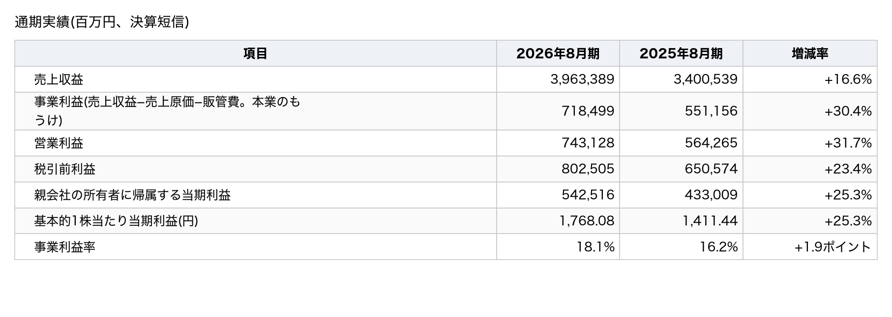
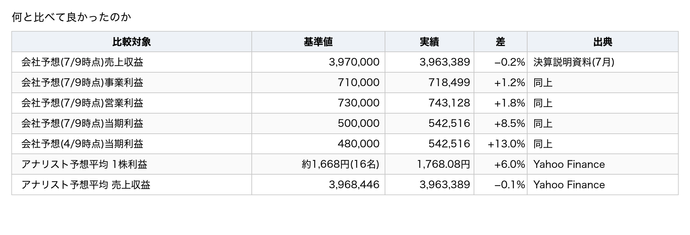
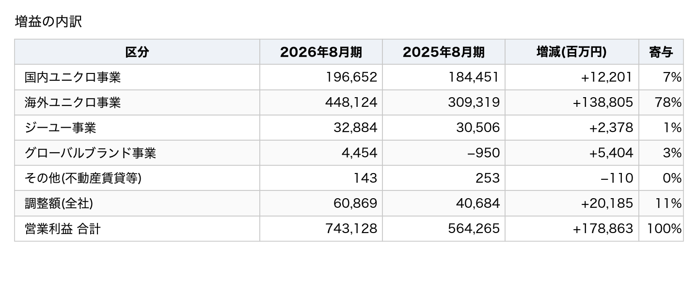
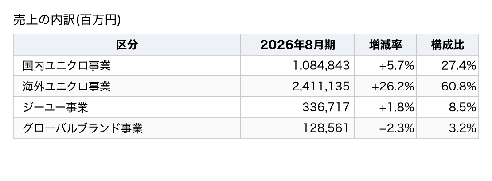
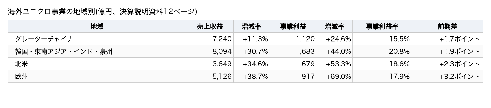
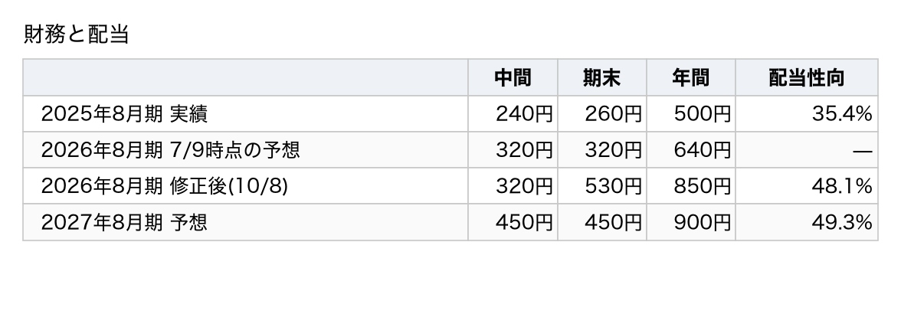
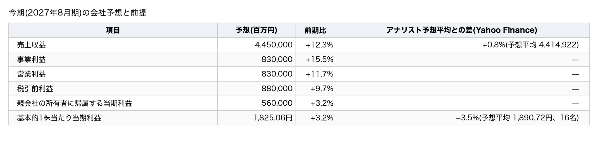
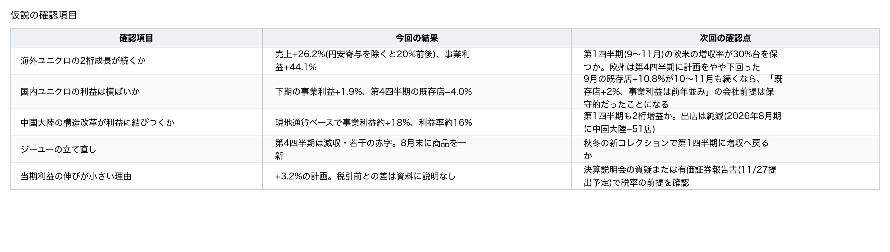

題名: 【決算メモ】ファーストリテイリング(9983)最高益でも翌日−4% — 海外ユニクロが利益の6割、今期の純利益は+3%の計画

このメモは、2026年8月期(2025年9月〜2026年8月)の通期決算を扱う。数字は決算短信と会社の決算説明資料から取った。株価・為替・アナリスト予想は米国版 Yahoo Finance(finance.yahoo.com)の掲載値を、報道の見出しは株探を使った(取得日時は出典欄に書いた)。本文の算出値と逆算は筆者の計算であり、会社の開示ではない。

## 0. 3行でわかる今回の決算

1. 売上収益は3兆9,634億円(前期比+16.6%)、事業利益は7,185億円(+30.4%)、親会社帰属の当期利益は5,425億円(+25.3%)だった。5期連続で過去最高を更新した(決算短信の記載)。
2. 今期(2027年8月期)の会社計画では、売上は+12.3%、事業利益は+15.5%と伸びるのに、当期利益は+3.2%にとどまる。前期の年間配当は、予想の640円から850円へ増えた。今期は900円を会社は計画している。
3. 利益は7月時点の会社予想を上回ったのに、翌営業日(10/9)の株価は4.0%下がった。

## 1. 実績

### 通期実績(百万円、決算短信)

売上は16.6%、事業利益は30.4%、当期利益は25.3%伸びた。事業利益率は18.1%で、1.9ポイント改善した。

### 有料部分で分かること

- 利益は会社予想を上回った。それなのに、株価はなぜ翌日4.0%下がったのか。売りのきっかけになった可能性が高い数字を示す。
- 増益1,789億円はどこから来たか。合計が一致する内訳表で、海外ユニクロが何%を稼いだかを示す。
- 事業利益+15.5%なのに当期利益+3.2%という今期計画のずれを、税率と非支配持分(子会社の利益のうち親会社以外の株主の取り分)の算術で説明する(会社資料には書かれていない)
- 粗利率・販管費率・在庫がどう動いたか、第4四半期(6〜8月)の伸びは鈍っていないかを示す。
- 次回(1月上旬の第1四半期)の決算で確かめる5項目を挙げる。

（ここに有料ラインを設定）

### 先に結論

- 翌日4.0%安のきっかけとして最も有力なのは、今期の1株利益の会社計画1,825.06円が、アナリスト予想平均1,890.72円(16名)を3.5%下回ったことである。当期利益の計画が+3.2%にとどまることと同じ話で、根拠は第4節と第5節に書いた(筆者の推論であり、会社も株探も明言していない)。
- 前期の当期利益は会社予想を425億円上回ったが、本業(事業利益)の上振れは84億円だけだった。上振れの半分以上は、事業利益より後の段階(税金や非支配持分)で生じた(第1節)。
- 今期の当期利益+3.2%は本業の減速ではなく、その税率が元の水準に戻る前提で説明がつく(第5節)。
- 増益1,789億円の78%は海外ユニクロが稼いだ(第2節)。

### 何と比べて良かったのか

日本株では会社予想が基準になる。アナリスト予想の平均は参考値として併記した。

7月時点の会社予想に対して、売上は0.2%下回り、事業利益は1.2%、当期利益は8.5%上回った。1株利益はアナリスト予想平均(16名)を6.0%上回った。

会社は7月に一度、事業利益の予想を6,900億円から7,100億円へ上方修正していた。実績はその修正後の数字をさらに上回った。売上だけは予想に届かず、会社も「売上は若干下回る」と書いている(決算説明資料3ページ)。

当期利益の上振れ425億円のうち、本業(事業利益)の上振れは84億円にすぎない。筆者は次のように分解した。

- 税引前利益の上振れは225億円だった(事業利益+84億円、その他収益+46億円、金融収益+93億円)。7月予想が暗に置いていた「税引前から親会社帰属への転換率」64.1%(5,000÷7,800)を掛けると、当期利益への寄与は約145億円になる。
- 残り約280億円は、転換率が実績で67.6%(5,425÷8,025)に上がったことで生じた。中身は、法人所得税の負担率(27.2%、前期29.4%)の低下と、非支配持分の差である。このうち主因は税率の低さだったと筆者は読む。
- その他収益の増加分には、営業取引から生じた為替差益の増加(60億円から153億円へ、決算短信の注記4)が含まれる。

「本業が予想以上に良かった」と読むと、上振れの半分以上を見誤ることになる。

## 2. 増益はどこから来たか

営業利益は前期比で1,788億6,300万円増えた。決算短信のセグメント情報で分解すると、合計が一致する。

営業利益の増加1,789億円のうち、海外ユニクロが78%、全社の調整額が11%、国内ユニクロが7%を占めた。

海外ユニクロ事業は増益の78%を占め、営業利益の60%(448,124÷743,128)に達した。

この表は、減損損失やその他収益を含む営業利益で分けている。本業のもうけである事業利益で見ると、次のようになる(決算短信2〜3ページ、億円)。海外ユニクロは44.1%伸びた。グローバルブランドは6.8%の小幅な増益にとどまった。事業利益で見ても、増益1,673億円の80%(1,345億円)は海外ユニクロが稼いだ。

- 国内ユニクロ事業: 1,960（2025年8月期: 1,813、増減率: +8.1%）
- 海外ユニクロ事業: 4,398（2025年8月期: 3,053、増減率: +44.1%）
- ジーユー事業: 315（2025年8月期: 283、増減率: +11.0%）
- グローバルブランド事業: 28（2025年8月期: 26、増減率: +6.8%）

営業利益の表でグローバルブランドが54億円の増益に見えるのには、減損損失の減少(2,308百万円から503百万円へ、18億円減。決算短信のセグメント注記)が効いている。事業利益の増加は2億円にとどまる。残り約34億円はその他収益・費用の変動によるもので、内訳は開示されていない。調整額(全社費用)の202億円の増加も、内訳は開示されていない。営業取引の為替差益の増加(93億円)の多くがここに含まれていると筆者は推測する。

### 売上の内訳(百万円)

海外ユニクロが売上の61%を占めて26.2%伸び、国内ユニクロは27%を占めて5.7%伸びた。ジーユーは1.8%伸び、グローバルブランドは2.3%減った。

### 海外ユニクロ事業の地域別(億円、決算短信の記載)

売上の伸びは欧州が38.7%、北米が34.6%、韓国・東南アジア等が30.7%、グレーターチャイナが11.3%だった。事業利益の伸びは欧州の69.0%が最も大きかった。

欧米の合計売上8,775億円は、グレーターチャイナ(7,240億円)と韓国・東南アジア等(8,094億円)のそれぞれを初めて上回った(決算短信2ページに「初めて抜き」と記載がある)。中国大陸は現地通貨ベースで売上が約3%、事業利益が約18%伸び、事業利益率は約16%に上がった(決算説明資料13ページ)。円ベースの数字より伸びは小さい。

### 円安の寄与

会社の決算説明資料によると、為替の影響は連結売上収益を通期で4.4%押し上げた。通貨別の寄与は、米ドルが5.0%、人民元が9.1%、ユーロが11.6%、ウォンが0.9%だった。売上の伸び16.6%から単純に差し引くと、為替を除く伸びは12%前後になる(概算であり、会社が開示する現地通貨ベースの数字ではない)。

### 粗利率・販管費率・在庫

- 売上総利益率は55.2%で、前期の53.8%から1.4ポイント上がった。会社は海外ユニクロの改善を主因に挙げている(決算説明資料)。
- 販管費率は37.1%で、前期の37.6%から0.5ポイント下がった。
- 棚卸資産(在庫)は6,172億円で、前期末の5,109億円から20.8%増えた。ただし、この増加には円安による換算の影響が含まれる。キャッシュフロー計算書の「棚卸資産の増減額」は757億円の増加である。これをもとにすると、換算の影響を除いた実質の増加は約15%になる。売上の伸び16.6%の範囲内である。内訳は、海外ユニクロが882億円増、国内ユニクロが146億円増、ジーユーが12億円増、グローバルブランドが21億円増だった(決算説明資料)。海外ユニクロの増加は事業拡大に伴うものである。国内ユニクロは夏物の在庫が増えたが、来期にかけて販売する計画だと会社は説明している。

在庫の伸びが売上の伸びを超えないかは、次回の確認項目に入れた。

### 第4四半期(6〜8月)単独(概算)

通期から第3四半期累計を引いて求めた。資料が億円単位なので丸めを含む。

- 売上収益(億円): 8,982（前年同期: 7,838、増減率: +14.6%）
- 事業利益(億円): 1,257（前年同期: 1,075、増減率: +17%）

伸びは通期(+30.4%)より鈍い。ただし、第4四半期の事業利益の実績は、7月時点の会社予想から逆算した1,173億円(7,100−5,927)を7%上回った。6〜8月は季節的に利益の小さい四半期なので、減速と読むには前年の水準と季節性を踏まえる必要がある。会社の説明によると、国内ユニクロの既存店売上は第4四半期に4.0%減った(6月−14.1%、7月+4.3%、8月−1.3%)。ジーユーは減収で、事業利益は若干の赤字だった。欧州は34%増収だったが、気温が高く計画をやや下回った。一方で、国内ユニクロの2026年9月の既存店売上は10.8%伸びた(決算説明資料)。

## 3. 財務と配当

手元の現金は1兆75億円である。総資産4兆5,495億円に対する親会社所有者帰属持分比率は62.6%で、前期末の58.9%から上がった。営業キャッシュフローは7,886億円で35.8%増えた。設備投資は1,127億円(前期1,719億円)だった。今期は1,334億円を会社は計画している。

年間配当は500円から850円(修正前の予想は640円)に増えた。今期は900円を会社は計画している。配当性向(利益のうち配当に回す割合)は35.4%、48.1%、49.3%と上がっていく。

期末配当は、11月5日に予定する取締役会の決議を前提としている。会社は配当性向を50%程度へ引き上げる方針を示した(決算説明資料28ページ)。配当予想の修正のお知らせでは、高成長を最優先しながら株主への高い還元を両立すると説明している。

## 4. 株価の反応

開示は10月8日の15時31分で、取引終了(15時30分)の直後だった。反応は翌営業日の10月9日の取引で出た。

- 10/8 終値(開示前の最後の値): 74,800円（補足: 前日比+0.03%）
- 10/9 始値: 75,500円（補足: 前日終値比+0.94%。取引開始時の値は高かった）
- 10/9 高値: 75,600円
- 10/9 安値: 71,620円
- 10/9 終値: 71,780円（補足: 前日終値比−4.04%）
- 10/9 出来高: 2,126,700株（補足: 直近20営業日平均(1,129,095株)の1.88倍）
- 同日の TOPIX連動上場投資信託(1306): +0.70%（補足: TOPIX の代理指標として使用）
- 同日の日経平均: −0.02%

- **値幅制限の確認**: 下限は59,800円(基準値段74,800円、制限値幅は上下15,000円。JPX)で、安値71,620円は届いていないので、ストップ安ではない。
- **通常の値動きとの比較**: 直近20営業日の前日比の絶対値平均は1.17%である。当日の4.04%はその3.5倍で、通常の変動の範囲を超えている。
- **市場との対比**: TOPIX の代理指標が0.7%上がり、日経平均がほぼ横ばい(−0.02%)の日に、この銘柄は4.0%下がった。株探の見出しは「地合い悪」を挙げているが、終値ベースの指数からは地合いの悪さを確認できない(日中の指数の推移は本メモでは見ていない)。日経平均は、株価の高い銘柄の値動きに左右されやすい指数である。それでも横ばいにとどまったのは、他の銘柄の上げがこの銘柄の下げを打ち消したためだと筆者は推測する。終値ベースで見るかぎり、この下げは銘柄固有の要因が大きい。

取引開始時は前日より高く始まり、その後に売られた(始値+0.9%から終値−4.0%へ)。

株探の見出しは「大幅反落、決算サプライズ限定的で地合い悪に押される」(2026-10-09 14:50)と「軟調、27年8月期は事業益16%増を計画・年間配当は50円増配も」(同 09:22)だった。見出しが挙げている要因は「決算サプライズが限定的だったこと」と「地合い」である。どの数字が期待に届かなかったかを、見出しは特定していない。

本メモの数字からは、次の点が候補になる。利益は会社予想を上回った。しかし今期の1株利益の会社予想1,825.06円は、アナリスト予想平均1,890.72円(16名)を3.5%下回った(平均値は発表翌日の取得値で、見直しが反映途中の可能性がある)。当期利益の計画も+3.2%にとどまる。「サプライズ限定的」がこの点を指している可能性はあるが、これは筆者の推論であり、会社も株探も明言していない。

参考(算出値であり、水準の評価は含まない): 10月9日の終値71,780円は、今期の会社予想1株利益1,825.06円の39.3倍にあたる(株価収益率、予想ベース)。前期実績1,768.08円に対しては40.6倍である。今期配当予想900円に対する配当利回りは1.25%になる。1株当たり親会社所有者帰属持分9,274.27円に対しては7.74倍(株価純資産倍率)になる。

## 5. 今期(2027年8月期)の会社予想と前提

今期は売上+12.3%、事業利益+15.5%、当期利益+3.2%を計画している。1株利益1,825.06円はアナリスト予想平均を3.5%下回る。

### なぜ当期利益だけ+3.2%なのか

税引前利益+9.7%と当期利益+3.2%の差は、税引前から親会社帰属までの4段で説明できる。会社資料に税率の前提は書かれていない。しかし、前期までの2年分の実績に今期計画を並べると、計画が置いている前提を逆算できる。

親会社帰属÷税引前は、前期の67.6%から今期計画の63.6%へ下がる。税率30%・非支配持分9%の前提を置けば再現できる(一例であり、組み合わせは一意ではない)。

今期計画の63.6%は、たとえば税率30%・非支配持分9%の組み合わせで再現できる(880,000×0.70×0.91=560,560百万円)。税率31.5%・非支配持分7.1%(前期と同じ比率)でも再現できる(880,000×0.685×0.929=560,001百万円)。組み合わせは一意に決まらないが、どちらの場合も税負担率は前期の27.2%より高くなる。筆者の読みはこうである。当期利益+3.2%は本業の減速ではない。前期に低かった税負担率が前期以前の水準(29〜31%)に戻る前提が主であり、非支配持分の比率の上昇は従である(筆者の推論であり、会社は税率も非支配持分の前提も開示していない)。前期の当期利益の上振れの半分以上が税率などによるものだったこと(第1節)と、今期の伸びが鈍いことは、同じ原因(前期の税率が低かったこと)から生じている。会社の実際の前提は、決算説明会の質疑か有価証券報告書(11月27日提出予定)で確かめる。

### 会社が置いた前提

- 為替は期中平均で156.2円/米ドル、181.8円/ユーロ、22.5円/人民元を前提にしており、前期実績と同じである。期末レート160.0円/米ドルを前提に、為替差損益は見込んでいない。10月8日の実勢は157.87円/米ドル、177.07円/ユーロだった(Yahoo Finance)。実勢は期中平均の前提156.2円より円安なので、損益の換算には有利に働く。一方で期末の前提160.0円より円高なので、外貨建て資産の換算には不利に働く。
- 金融収益・費用は500億円のプラスを見込む(前期593億円)。その他収益・費用は見込んでいない(前期246億円)。
- 国内ユニクロは、既存店売上が2%程度伸び、事業利益は前年並みという前提である。仕入れ代金の支払いにあらかじめ決めておく為替レート(為替予約)が前期より円安になり、原価率が上がる前提を置いている(決算説明資料)。
- 海外ユニクロは、上期・下期・通期とも2桁の増収増益を見込む。
- 店舗数は期末3,545店(純増35店)を見込む。海外ユニクロは105店を出店し70店を閉め、国内ユニクロは純増ゼロである。
- 設備投資は1,334億円を計画している(前期1,127億円)。

## 6. 次回の決算で確かめること

この節の確認項目は、会社が今期計画の前提に置いた読み(海外ユニクロの2桁の増収増益が続き、国内は横ばい)が成り立っているかを確かめるためのものである。保有や売買の判断基準ではない。初回なので前回の答え合わせはない。次回は1月上旬の第1四半期(9〜11月)で答え合わせをする。

**海外ユニクロの2桁成長が続くか**
- 今回の結果: 売上は26.2%、事業利益は44.1%伸びた(事業利益ベース、決算短信)
- 次回の確認点: 第1四半期(9〜11月)の欧米の増収率が30%台(筆者の目安。会社の計画は「2桁の増収増益」)を保つか。欧州は第4四半期に計画をやや下回った

**国内ユニクロの利益は横ばいか**
- 今回の結果: 下期の事業利益は1.9%伸び、第4四半期の既存店売上(前年からある店舗の売上)は4.0%減った
- 次回の確認点: 9月の既存店+10.8%が10〜11月も続くなら、会社前提(既存店+2%)を上回って推移していることになる

**中国大陸の構造改革が利益に結びつくか**
- 今回の結果: 現地通貨ベースで事業利益が約18%伸び、事業利益率は約16%になった(決算説明資料13ページ)
- 次回の確認点: 第1四半期も2桁増益か。店舗は純減が続く(2026年8月期に中国大陸で51店減、同29ページ)

**ジーユーは増収に戻るか**
- 今回の結果: 第4四半期は減収で、事業利益は若干の赤字だった。8月末から商品を一新した(決算説明資料17ページ)
- 次回の確認点: 秋冬の新コレクションで、第1四半期に増収へ戻るか

**税率と在庫**
- 今回の結果: 税負担率は27.2%だった。棚卸資産は20.8%増えた(換算の影響を除くと約15%増、売上は16.6%増)
- 次回の確認点: 第1四半期の税負担率が29〜31%に戻るか。在庫の伸びが売上の伸びの範囲に収まるか

第1四半期に海外ユニクロの増収率が現地通貨ベースで1桁台に落ち、かつ事業利益率が前年同期を下回った場合、会社計画の前提が崩れたとみなす。

## 7. 次の予定

- 期末配当の決議: 2026-11-05(取締役会、会社資料)
- 国内ユニクロの10月の月次既存店売上: 11月初旬(会社サイト)
- 定時株主総会: 2026-11-26 / 有価証券報告書の提出: 2026-11-27(決算短信)
- 次回決算(第1四半期)の予定日: 会社は公表していない。前年は1月8日に発表した(会社の資料名より)。
- 直近の休場日: 2026-10-12(月、スポーツの日)(JPX)

次回のメモは、第1四半期の発表翌営業日(1月上旬の見込み)に、第6節の5項目の答え合わせから始める。

## 出典

- [2026年8月期 決算短信〔IFRS会計基準〕(連結)](https://www.release.tdnet.info/inbs/140120261008547647.pdf)(TDnet、2026-10-08 15:31 開示。2026-10-09 取得)
- [2026年8月期の配当予想の修正に関するお知らせ](https://www.release.tdnet.info/inbs/140120261008547876.pdf)(TDnet、同上)
- [2026年8月期 決算説明資料](https://www.fastretailing.com/jp/ir/library/pdf/20261008_results.pdf)、[2026年8月期 第3四半期 決算説明資料](https://www.fastretailing.com/jp/ir/library/pdf/20260709_results.pdf)(会社サイト、2026-10-09 取得)
- 米国版 Yahoo Finance(finance.yahoo.com): 株価・出来高(2026-10-09 終値、2026-10-10 取得)、為替(2026-10-08、2026-10-09 取得)、アナリスト予想平均と人数(2026-10-09 取得。掲載の集計値で、筆者の予想ではない)
- 株探: [銘柄ニュース一覧](https://kabutan.jp/stock/news?code=9983)の記事見出し(2026-10-09 09:22、14:50。2026-10-10 取得)
- JPX: [制限値幅](https://www.jpx.co.jp/equities/trading/domestic/06.html)の区分、[休業日一覧](https://www.jpx.co.jp/corporate/about-jpx/calendar/index.html)(2026-10-10 取得)
- 本文の算出値(株価指標)、上振れの分解、税率と非支配持分の逆算は筆者の計算で、会社の開示ではない

> **免責事項**: 本資料は、公開情報(TDnet の開示資料、会社の決算説明資料)および Yahoo Finance・株探に掲載された情報をもとに、不特定多数の読者向けに作成した情報提供資料です。筆者は金融商品取引業(投資助言・代理業を含む)の登録を受けておらず、本資料は特定の金融商品の売買を推奨・勧誘・助言するものではなく、特定の読者の投資目的や財産状況を考慮したものでもありません。会社予想・アナリスト予想は各発表者の前提に基づく将来情報で、その実現を保証するものではありません。株価・為替・アナリスト予想は取得時点(出典欄に記載)の値で、その後変動します。第三者の情報の権利は各提供者に帰属します。本資料中の算出値や逆算・推論は筆者の計算によるもので、会社の開示ではありません。掲載情報の正確性・完全性は保証されず、本資料に基づいて行った投資判断により生じた損失について、筆者は法令で認められる範囲で責任を負いません。筆者は公開時点で当該銘柄を保有していません。コメント欄等での個別の売買相談には応じません。
